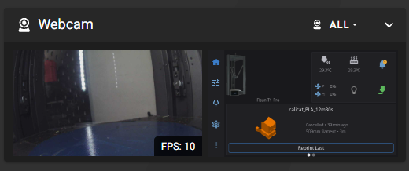

# FLSUN_RemoteScreen

View and control the **FLSun T1 Pro** touchscreen from any web browser on a phone, tablet or computer. This is the same kind of remote screen that the Snapmaker U1 Extended Firmware offers.

Open `http://<printer-ip>/screen/` to see the printer's screen live. Click or tap to press its buttons, and drag to swipe or scroll.

## What it does

- Mirrors the 480×272 screen and refreshes as soon as anything on it changes.
- Shows the screen, touchable, as a second webcam in the Mainsail and Fluidd dashboard.
- Turns clicks, taps and drags into real touches on the printer's screen.
- Works with HelixScreen and with FLSun's stock screen. Each one calibrates the touch panel differently, so the plugin follows whichever screen is running.
- Uses the same login as Mainsail and Fluidd. If Moonraker asks for a login, the screen asks for it too.
- Can be installed as an app from the browser's "Add to Home Screen".
- Updates from Mainsail's and Fluidd's update manager.

It needs nothing beyond what's already on the printer, and it sends a new image only when the screen changes, so it uses very little CPU.

## Install

SSH into the printer as `pi` (the default password is `1`).

1. Prepare the system. FLSun's system image can't reach GitHub as shipped: the clock starts about a year and a half in the past, the certificate links are missing, and git's https support was removed. These commands fix all three (skip them if [FLSUN_Timelapse](https://github.com/DIEHARDave/FLSUN_Timelapse) is already installed; it makes the same fixes):

   ```sh
   sudo ntpdate -u -b time.google.com
   curl -fsSL --cacert /etc/ssl/certs/ca-certificates.crt https://raw.githubusercontent.com/DIEHARDave/FLSUN_RemoteScreen/main/prepare.sh | bash
   ```

   Don't use `timedatectl set-ntp true`: on this image it stops the time service rather than starting it.

2. Download and install:

   ```sh
   cd ~
   git clone https://github.com/DIEHARDave/FLSUN_RemoteScreen.git
   ~/FLSUN_RemoteScreen/install.sh
   ```

The installer runs the system fixes again and installs a boot service that keeps the clock right, so the fixes are in place whichever FLSun plugin you install first. It restarts Moonraker but not Klipper, so it's safe to run during a print. Run it again after a FLSun firmware update that resets the web server.

**Updating from v0.1.x:** run `~/FLSUN_RemoteScreen/install.sh` once after updating. v0.2.0 renames the service from `flsun-remote-screen` to `flsun_remote_screen`, because FLSun's Moonraker only restarts a service named like its update manager entry. Until you do, the update manager can't restart the remote screen after an update.

## Use

Open `http://<printer-ip>/screen/` in a browser. The dot in the top-right corner is green while the page is connected; the button next to it switches to full screen.

If the printer's screen has gone dark to save power, the page shows black. Tap anywhere to wake it, just as you would on the printer.

### In the Mainsail and Fluidd dashboard

The installer also adds a second webcam named **Screen**, so the printer's screen appears next to the camera in the dashboard's webcam panel:



The Screen webcam embeds the `/screen/` page, so you can tap and swipe it right in the dashboard. This needs a Mainsail or Fluidd that can show a web page as a webcam (the "iframe" type), such as the current releases. FLSun's stock Mainsail 2.12 can't, so with it, open `/screen/` to touch. If you installed an earlier version, run `~/FLSUN_RemoteScreen/install.sh` again to switch the webcam over.

The installer always lists Screen after your camera, so FLSUN_Timelapse keeps recording the camera and HelixScreen's camera view keeps showing it. Both use the first webcam Moonraker lists. To leave the Screen webcam out, install with `~/FLSUN_RemoteScreen/install.sh --no-webcam`, or delete it later in Mainsail's or Fluidd's webcam settings.

## Settings

Options are in `~/printer_data/config/flsun_remote_screen.env`. The installer creates this file once and never overwrites it. After editing it, run `sudo systemctl restart flsun_remote_screen`.

| Option | Default | Meaning |
|---|---|---|
| `--mapping` | `auto` | Which touch calibration to follow: `helixscreen` (its `input.touch_range`), `tslib` (FLSun's `/etc/pointercal`) or `linear`. `auto` picks the one belonging to the screen that's running. |
| `--compression` | `1` | PNG compression level, 0–9. Higher levels send smaller images but use more CPU. |
| `--touch` | `/dev/input/event1` | Touch panel device |
| `--fb` | `/dev/fb0` | Framebuffer device |
| `--port` | `8093` | Local port that nginx forwards to |

If you recalibrate HelixScreen's touch, the remote screen picks up the new calibration automatically.

## What the installer changes

| File | Change |
|---|---|
| `/etc/systemd/system/flsun_remote_screen.service` | New service. It runs `server/remote_screen.py` as `pi`, with the `video` and `input` groups so it can read the screen and send touches |
| `/etc/nginx/snippets/flsun-remote-screen.conf` | New file: the `/screen/` web paths |
| `/etc/nginx/sites-available/mainsail` | Adds one `include` line for the snippet (a backup is saved first) |
| `~/printer_data/config/flsun_remote_screen.conf` | New file: update manager entry |
| `~/printer_data/config/flsun_remote_screen.env` | New file: options |
| `~/printer_data/config/moonraker.conf` | Adds `[include flsun_remote_screen.conf]` (a backup is saved first) |
| `~/printer_data/moonraker.asvc` | Adds `flsun_remote_screen`, so the update manager can restart it |
| Moonraker webcams | Adds the **Screen** webcam (`/screen/snapshot`), listed after your camera; skipped with `--no-webcam` |
| System clock | Sets it now, and adds `flsun-timesync.service` (`/usr/local/bin/flsun-timesync`), which sets it at every boot, saves it to `/etc/lasttime` and restarts ntpd. FLSun's `/etc/monitor` restores the date from that file at each boot but, because of a bug, never updates it, so without this fix the clock returns to the same old date after every boot |
| `/etc/ssl/certs` | Rebuilds the missing certificate links (`update-ca-certificates`) |
| git | Reinstalls Debian's git package (2.20.1-2+deb10u9) to restore the https support FLSun deleted |

FLSUN_Timelapse makes the same three system fixes with the same files, so installing both plugins, in either order, is safe.

## How it works

`server/remote_screen.py` uses only the Python standard library that ships on the printer (3.7, with no Pillow or pip):

- **Screen:** it reads `/dev/fb0` and encodes a PNG with zlib, which takes about 25 ms on the T1 Pro. A checksum of the pixels serves as the ETag. The page long-polls `/screen/snapshot?wait=10`, and the server holds that request until the screen changes, so updates arrive quickly without repeated requests. `/screen/stream` serves the same images as a multipart stream.
- **Touch:** it writes multitouch (protocol B) events into the touch panel's own input device, so the screen software receives them as real touches. The panel's raw axes are swapped and mirrored relative to the display, so each click is converted with the inverse of the running screen's calibration. A press with no events for 4 seconds is released automatically, in case the browser disconnects mid-touch.
- **Access:** the server listens only on 127.0.0.1. nginx serves the page and forwards the image and touch requests after asking Moonraker (`/access/user`) whether the client is allowed.

## Uninstall

```sh
~/FLSUN_RemoteScreen/uninstall.sh
rm -rf ~/FLSUN_RemoteScreen
```

The system fixes (clock service, certificate links, git) stay, because they help the rest of the printer too, and FLSUN_Timelapse relies on them.

## Credits

- [Snapmaker U1 Extended Firmware](https://github.com/paxx12/SnapmakerU1-Extended-Firmware) and the `fb-http` app from [paxx12/screen-apps](https://github.com/paxx12/screen-apps), which this design follows

Licensed under GPLv3.
